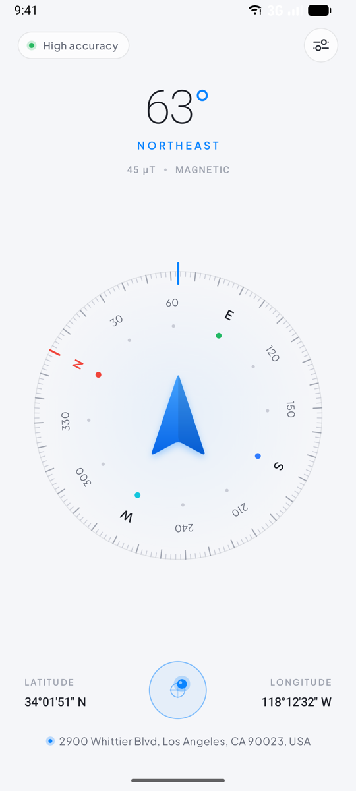
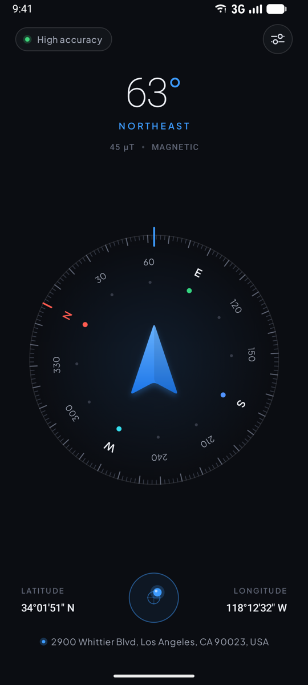
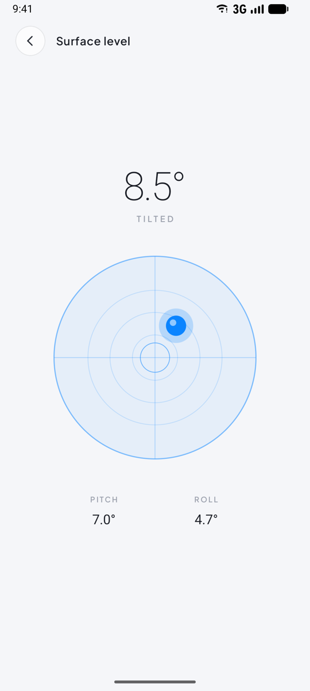
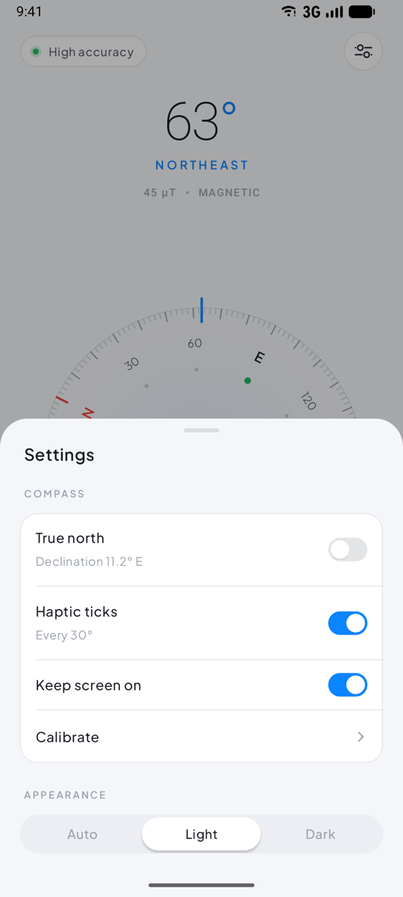
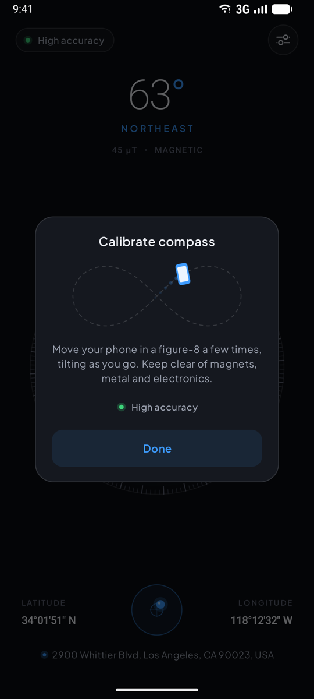

<div align="center">


# Compass

**A fast, precise compass and surface level for Android — built with Jetpack Compose.**

[](https://github.com/ShayorForYou/compass/actions/workflows/ci.yml)
[](https://github.com/ShayorForYou/compass/releases/latest)


[**Download the latest APK**](https://github.com/ShayorForYou/compass/releases/latest)

</div>

<br />

<table align="center">
  <tr>
    <td align="center"></td>
    <td align="center"></td>
    <td align="center"></td>
  </tr>
  <tr>
    <td align="center"><sub>Light</sub></td>
    <td align="center"><sub>Dark</sub></td>
    <td align="center"><sub>Surface level</sub></td>
  </tr>
  <tr>
    <td align="center"></td>
    <td align="center"></td>
    <td></td>
  </tr>
  <tr>
    <td align="center"><sub>Settings</sub></td>
    <td align="center"><sub>Calibration</sub></td>
    <td></td>
  </tr>
</table>

## Features

- **Smooth, stable heading** — fused rotation-vector sensor (gyro-assisted), with an accelerometer + magnetometer fallback. The heading stays steady whether the phone is flat or upright.
- **Precision dial** — 2° tick ring, colour-coded cardinal points and a fixed lubber line; the needle eases toward each reading in sync with the display refresh rate.
- **True or magnetic north** — corrects for local magnetic declination using your location.
- **Live coordinates & address** — latitude/longitude in degrees-minutes-seconds plus a reverse-geocoded street address.
- **Surface level** — mini bubble level on the main screen; tap it for a full-screen level with pitch and roll.
- **Calibration guide** — accuracy indicator that pulses when calibration is needed, an animated figure-8 guide, and automatic completion once accuracy reaches *High*.
- **Haptic ticks** — a gentle tick at every 30° mark, stronger on cardinal points.
- **Light, dark or auto theme** with a smooth cross-fade, plus *keep screen on*.

## Performance

The app is designed to stay at the display's full frame rate while using as little power as possible:

| Technique | Effect |
| --- | --- |
| Sensors are read on a dedicated background thread and published through lock-free volatile fields | Sensor callbacks never block the UI thread |
| One frame-synced loop eases the needle and bubble with a frame-rate–independent filter | Smooth motion at 60/90/120 Hz, independent of the sensor rate |
| The loop **suspends** when everything has settled, until the next sensor sample | A still phone costs no frames |
| The dial is drawn once and rotated as a hardware layer | Turning the phone never re-measures text or redraws the dial |
| Per-frame values are read only in draw/layer lambdas | No recomposition while the compass moves |
| Sensors and GPS are active only while the app is visible; geocoding is rate-limited and distance-gated | Minimal battery and network use |

The release APK is under 1 MB.

## Install

Download `compass-<version>.apk` from the [latest release](https://github.com/ShayorForYou/compass/releases/latest) and open it on your phone (you may need to allow installs from your browser or file manager).

Requires Android 7.0 (API 24) or newer. A magnetometer is needed for the compass; the level works on any device with an accelerometer.

## Build from source

**Requirements:** Android Studio (or any JDK 17+) and the Android SDK. Gradle runs on JDK 25 ([`gradle/gradle-daemon-jvm.properties`](gradle/gradle-daemon-jvm.properties)) and downloads it automatically if it isn't installed; the required SDK platform and build tools are downloaded on first build too.

```bash
git clone git@github.com:ShayorForYou/compass.git
cd compass

./gradlew assembleDebug          # debug APK  → app/build/outputs/apk/debug/
./gradlew installDebug           # build and install on a connected device
./gradlew lintDebug              # run Android lint
```

Or open the folder in Android Studio and press **Run**.

A local `./gradlew assembleRelease` is signed with the debug key so it installs straight away; signed release builds come from CI (below).

## Project structure

```
app/src/main/java/com/shayor/compass/
├── MainActivity.kt            Lifecycle, permissions, theme, keep-screen-on
├── sensor/CompassEngine.kt    Sensor fusion on a background thread
├── location/LocationTracker.kt  LocationManager + reverse geocoding
├── data/AppSettings.kt        Persisted, observable preferences
└── ui/
    ├── CompassScreen.kt       Main screen layout
    ├── CompassDial.kt         Rotating dial and arrow
    ├── LiveReadings.kt        Frame-synced smoothing loop and haptics
    ├── Level.kt               Bubble level and full-screen level
    ├── Calibration.kt         Calibration guide
    ├── SettingsSheet.kt       Settings bottom sheet
    ├── Glyphs.kt              Custom-drawn icons, accuracy pill, switch
    └── theme/Theme.kt         Colours, typography (Plus Jakarta Sans)
```

## CI/CD

Two GitHub Actions workflows live in [`.github/workflows`](.github/workflows):

| Workflow | Runs on | What it does |
| --- | --- | --- |
| [**CI**](.github/workflows/ci.yml) | Every push to `main` and every pull request | Android lint + debug build; uploads the debug APK and lint report as artifacts |
| [**Release**](.github/workflows/release.yml) | Pushing a tag like `v1.2.0` | Builds a **signed** APK, verifies the signature, and publishes a GitHub Release with the APK and its SHA-256 checksum |

Dependabot ([`.github/dependabot.yml`](.github/dependabot.yml)) opens weekly PRs for Gradle dependencies and GitHub Actions.

### Signing secrets

The release workflow signs with your upload keystore, supplied through four repository secrets
(**Settings → Secrets and variables → Actions → New repository secret**):

| Secret | Value |
| --- | --- |
| `KEYSTORE_BASE64` | Your `.jks` file, base64-encoded (see below) |
| `KEYSTORE_PASSWORD` | Keystore password |
| `KEY_ALIAS` | Key alias inside the keystore |
| `KEY_PASSWORD` | Key password |

Encode the keystore and copy it to the clipboard:

```bash
# macOS
base64 -i path/to/release.jks | pbcopy
# Linux
base64 -w 0 path/to/release.jks
```

Or set all four with the [GitHub CLI](https://cli.github.com/):

```bash
base64 -i path/to/release.jks | gh secret set KEYSTORE_BASE64
gh secret set KEYSTORE_PASSWORD        # prompts for the value
gh secret set KEY_ALIAS
gh secret set KEY_PASSWORD
```

The keystore is decoded only inside the runner's temp directory and deleted at the end of the job. `*.jks` and `*.keystore` are git-ignored so a key can't be committed by accident.

### Cutting a release

```bash
git tag v1.0.0
git push origin v1.0.0
```

The tag sets the app's `versionName` (`1.0.0`); `versionCode` is the workflow run number, so it always increases. Tags containing a hyphen (e.g. `v1.1.0-beta.1`) are published as pre-releases.

## Permissions & privacy

| Permission | Why |
| --- | --- |
| `ACCESS_FINE_LOCATION` / `ACCESS_COARSE_LOCATION` | Coordinates, street address and true-north correction. Optional — the compass works without it. |

There are no ads, analytics or trackers, and the app has no backend of its own. Your location stays on the device, except that Android's built-in geocoder (normally provided by Google Play services) looks up the street address for your coordinates.
